# Ortol — Modello dei dati

Questo documento descrive le informazioni che Ortol deve conservare in modo permanente e come organizzarle in un **database relazionale**: tabelle, attributi, chiavi primarie (PK), chiavi esterne (FK), vincoli e indici.

Oggi l'applicazione salva gli stessi dati in file JSON (`App_Data/users.json`, `App_Data/gardens.json`) e legge il catalogo delle piante da `Data/plants.json`. Lo schema qui descritto è pensato per sostituirli 1:1. Lo script pronto da eseguire è in [`schema.sql`](schema.sql) (PostgreSQL; note per SQLite in fondo).

---

## 1. Diagramma relazionale

Il diagramma qui sotto è in Mermaid: GitHub lo disegna direttamente. La stessa figura è anche in [`er-diagram.svg`](er-diagram.svg) / [`er-diagram.png`](er-diagram.png).

```mermaid
erDiagram
    USERS ||--o{ GARDENS : "possiede"
    CLIMATE_PROFILES ||--o{ GARDENS : "descrive il clima di"
    CLIMATE_PROFILES ||--|{ CLIMATE_MONTHLY : "12 mesi"
    GARDENS ||--o{ LOTS : "è diviso in"
    GARDENS ||--o{ CROPS : "ospita"
    LOTS |o--o{ CROPS : "contiene (max 1 attiva)"
    PLANT_SPECIES ||--o{ CROPS : "è la specie di"
    CROPS ||--o{ CARE_LOGS : "registro operazioni"
    PLANT_SPECIES ||--o{ SPECIES_RELATIONS : "consociazioni"
    PLANT_SPECIES |o--o{ SPECIES_RELATIONS : "specie correlata"
    PLANT_SPECIES ||--o{ SPECIES_PESTS : "avversità"
    PLANT_SPECIES ||--o{ SPECIES_TIPS : "consigli"

    USERS {
        uuid id PK
        varchar username UK "3-40 caratteri, univoco senza distinzione maiuscole"
        varchar display_name
        varchar password_hash "PBKDF2-SHA256"
        user_role role "User | Admin"
        boolean disabled
        varchar security_stamp "cambia a reset password / disattivazione"
        timestamptz created_at
        timestamptz last_login_at "nullable"
    }

    GARDENS {
        uuid id PK
        uuid owner_id FK "→ users.id"
        uuid climate_profile_id FK "→ climate_profiles.id, nullable"
        varchar name
        varchar city
        varchar region "nullable"
        varchar country "nullable"
        numeric latitude
        numeric longitude
        numeric elevation_m "nullable"
        soil_type soil "Sabbioso | MedioImpasto | Argilloso"
        cultivation_type cultivation "Terra | Vaso"
        numeric width_m "asse X"
        numeric length_m "asse Y"
        timestamptz created_at
    }

    CLIMATE_PROFILES {
        uuid id PK
        numeric lat_key UK "latitudine arrotondata a 0,01°"
        numeric lon_key UK "longitudine arrotondata a 0,01°"
        varchar source "es. Open-Meteo ERA5"
        varchar period "es. 2015–2024"
        boolean estimated "true = stima teorica"
        smallint last_spring_frost_doy "nullable"
        smallint first_autumn_frost_doy "nullable"
        smallint frost_free_days
        numeric annual_precipitation_mm
        numeric annual_mean_temp_c
        timestamptz computed_at
    }

    CLIMATE_MONTHLY {
        uuid climate_profile_id PK,FK "→ climate_profiles.id"
        smallint month PK "1-12"
        numeric t_max_c
        numeric t_min_c
        numeric t_mean_c
        numeric precipitation_mm
        numeric et0_mm
        numeric frost_days
        numeric hot_days
    }

    LOTS {
        uuid id PK
        uuid garden_id FK "→ gardens.id"
        varchar name
        numeric x_m "origine in alto a sinistra"
        numeric y_m
        numeric width_m ">= 0,1"
        numeric length_m ">= 0,1"
        numeric depth_cm "solo in vaso, nullable"
    }

    CROPS {
        uuid id PK
        uuid garden_id FK "→ gardens.id"
        uuid lot_id FK "→ lots.id, nullable"
        varchar species_id FK "→ plant_species.id"
        varchar label "nullable"
        integer quantity "numero di piante"
        date planted_on
        boolean active
        date ended_on "nullable"
        text notes "nullable"
    }

    CARE_LOGS {
        uuid id PK
        uuid crop_id FK "→ crops.id"
        care_type type "Water | Fertilize | Harvest | Note"
        date log_date
        numeric amount "L, g o kg secondo il tipo; nullable"
        text note "nullable"
        timestamptz created_at
    }

    PLANT_SPECIES {
        varchar id PK "slug, es. pomodoro"
        varchar name
        varchar scientific_name
        varchar family
        varchar category
        varchar emoji
        text description
        varchar lifecycle
        varchar planting_method
        numeric planting_temp_min_c
        numeric planting_temp_max_c
        numeric sowing_depth_cm
        smallint spacing_row_cm
        smallint spacing_plant_cm
        numeric germ_min_c
        numeric germ_opt_c
        numeric base_gdd_c
        numeric growth_min_c
        numeric opt_min_c
        numeric opt_max_c
        numeric growth_max_c
        boolean frost_tender
        numeric min_survival_c
        numeric gdd_to_maturity
        smallint days_to_maturity
        smallint harvest_window_days
        boolean continuous_harvest
        boolean needs_vernalization
        numeric kc_ini
        numeric kc_mid
        numeric kc_end
        smallint stage_ini_days
        smallint stage_dev_days
        smallint stage_mid_days
        smallint stage_late_days
        numeric root_depth_min_m
        numeric root_depth_max_m
        numeric depletion_fraction
        text water_notes
        numeric ph_min
        numeric ph_max
        varchar sun
        text soil_notes
        varchar nutrient_demand
        smallint fert_start_after_days
        smallint fert_interval_days
        smallint fert_stop_before_end_days
        text fert_vegetative
        text fert_reproductive
        text fert_organic
        text harvest_signs
        text harvest_tips
        numeric yield_kg_m2
        container_suitability container_suitability
        numeric container_min_liters
        numeric container_min_depth_cm
        text container_notes
    }

    SPECIES_RELATIONS {
        varchar species_id PK,FK "→ plant_species.id"
        varchar related_name PK "anche specie fuori catalogo"
        relation_kind kind PK "Companion | Antagonist"
        varchar related_species_id FK "→ plant_species.id, nullable"
    }

    SPECIES_PESTS {
        varchar species_id PK,FK "→ plant_species.id"
        smallint position PK
        varchar name
    }

    SPECIES_TIPS {
        varchar species_id PK,FK "→ plant_species.id"
        smallint position PK
        text tip
    }
```

**Lettura delle cardinalità** (notazione "crow's foot"):

| Relazione | Cardinalità | Significato |
|---|---|---|
| users → gardens | 1 : N | un utente possiede zero o più orti; ogni orto ha un solo proprietario |
| climate_profiles → gardens | 1 : N | più orti nella stessa località condividono le stesse normali climatiche |
| climate_profiles → climate_monthly | 1 : 12 | esattamente una riga per mese |
| gardens → lots | 1 : N | lo spazio visto dall'alto è diviso in lotti (o vasi) |
| gardens → crops | 1 : N | tutte le colture dell'orto, attive e concluse |
| lots → crops | 0..1 : N | nel tempo un lotto ospita più colture, **al massimo una attiva**; una coltura conclusa può non avere più lotto |
| plant_species → crops | 1 : N | ogni coltura è di una specie del catalogo |
| crops → care_logs | 1 : N | registro di irrigazioni, concimazioni, raccolti e note |
| plant_species → species_relations / pests / tips | 1 : N | liste della scheda agronomica |

---

## 2. Dati di dominio utente

### 2.1 `users` — account
| Attributo | Tipo | Vincoli | Descrizione |
|---|---|---|---|
| **id** | uuid | **PK** | identificativo |
| username | varchar(40) | NOT NULL, UNIQUE (case-insensitive) | nome di accesso; lettere, numeri e `. _ - @` |
| display_name | varchar(80) | NOT NULL | nome mostrato |
| password_hash | varchar(200) | NOT NULL | `pbkdf2-sha256$iterazioni$sale$hash`, mai la password in chiaro |
| role | user_role | NOT NULL, default `User` | `User` o `Admin` |
| disabled | boolean | NOT NULL, default false | account bloccato |
| security_stamp | varchar(32) | NOT NULL | rigenerato a cambio password/ruolo/stato: invalida le sessioni aperte |
| created_at | timestamptz | NOT NULL | creazione |
| last_login_at | timestamptz | NULL | ultimo accesso |

Regola applicativa: deve sempre esistere almeno un amministratore attivo.

### 2.2 `gardens` — orti
| Attributo | Tipo | Vincoli | Descrizione |
|---|---|---|---|
| **id** | uuid | **PK** | |
| *owner_id* | uuid | **FK → users.id**, NOT NULL, ON DELETE CASCADE | proprietario |
| *climate_profile_id* | uuid | **FK → climate_profiles.id**, NULL, ON DELETE SET NULL | normali climatiche della località |
| name | varchar(100) | NOT NULL | |
| city, region, country | varchar | city NOT NULL | località scelta con la geocodifica |
| latitude, longitude | numeric(8,5) | NOT NULL, range valido | coordinate |
| elevation_m | numeric(6,1) | NULL | quota |
| soil | soil_type | NOT NULL | tipo di terreno (usato per l'acqua disponibile) |
| cultivation | cultivation_type | NOT NULL | `Terra` o `Vaso` |
| width_m, length_m | numeric(6,2) | NOT NULL, tra 0,2 e 200 | dimensioni dello spazio coltivabile |
| created_at | timestamptz | NOT NULL | |

La superficie (`width_m × length_m`) è un dato derivato e non va memorizzato.

### 2.3 `lots` — lotti / vasi della vista dall'alto
| Attributo | Tipo | Vincoli | Descrizione |
|---|---|---|---|
| **id** | uuid | **PK** | |
| *garden_id* | uuid | **FK → gardens.id**, NOT NULL, ON DELETE CASCADE | |
| name | varchar(60) | NOT NULL | |
| x_m, y_m | numeric(6,3) | NOT NULL, ≥ 0 | posizione dell'angolo in alto a sinistra |
| width_m, length_m | numeric(6,3) | NOT NULL, ≥ 0,1 | misure |
| depth_cm | numeric(5,1) | NULL, 5–150 | profondità del contenitore (solo coltivazione in vaso) |

Vincoli applicativi (verificati dal backend al salvataggio della disposizione): il lotto sta dentro i confini dell'orto e non si sovrappone ad altri lotti dello stesso orto.

### 2.4 `crops` — colture (piantagioni)
| Attributo | Tipo | Vincoli | Descrizione |
|---|---|---|---|
| **id** | uuid | **PK** | |
| *garden_id* | uuid | **FK → gardens.id**, NOT NULL, ON DELETE CASCADE | |
| *lot_id* | uuid | **FK → lots.id**, NULL, ON DELETE SET NULL | lotto occupato; NULL se conclusa o non assegnata |
| *species_id* | varchar(40) | **FK → plant_species.id**, NOT NULL, ON DELETE RESTRICT | specie |
| label | varchar(100) | NULL | etichetta libera (es. varietà) |
| quantity | integer | NOT NULL, > 0 | numero di piante (calcolato da superficie o volume) |
| planted_on | date | NOT NULL | messa a dimora |
| active | boolean | NOT NULL, default true | coltura in corso |
| ended_on | date | NULL | data di conclusione |
| notes | text | NULL | |

**Indice univoco parziale**: `UNIQUE (lot_id) WHERE active` — al massimo una coltura attiva per lotto.

### 2.5 `care_logs` — registro delle operazioni
| Attributo | Tipo | Vincoli | Descrizione |
|---|---|---|---|
| **id** | uuid | **PK** | |
| *crop_id* | uuid | **FK → crops.id**, NOT NULL, ON DELETE CASCADE | |
| type | care_type | NOT NULL | `Water`, `Fertilize`, `Harvest`, `Note` |
| log_date | date | NOT NULL | giorno dell'operazione |
| amount | numeric(8,2) | NULL, ≥ 0 | litri (acqua), grammi (concime), kg (raccolto) |
| note | text | NULL | es. "Protezione: temporale forte" |
| created_at | timestamptz | NOT NULL | momento di registrazione, ordina le operazioni dello stesso giorno |

Indice: `(crop_id, log_date DESC, created_at DESC)` per le "ultime operazioni".

---

## 3. Dati climatici (cache)

### 3.1 `climate_profiles`
Normali climatiche calcolate da 10 anni di dati giornalieri (rianalisi ERA5). Sono uguali per tutti gli orti della stessa località, quindi la chiave naturale è la coppia di coordinate arrotondate.

| Attributo | Tipo | Vincoli | Descrizione |
|---|---|---|---|
| **id** | uuid | **PK** | |
| lat_key, lon_key | numeric(6,2) | NOT NULL, **UNIQUE (lat_key, lon_key)** | coordinate arrotondate a 0,01° (~1 km) |
| source, period | varchar | NOT NULL | origine dei dati |
| estimated | boolean | NOT NULL | `true` se stima teorica (archivio non raggiungibile): da ricalcolare |
| last_spring_frost_doy, first_autumn_frost_doy | smallint | NULL, 1–366 | giorno dell'anno mediano |
| frost_free_days | smallint | NOT NULL | durata della stagione senza gelo |
| annual_precipitation_mm, annual_mean_temp_c | numeric | NOT NULL | |
| computed_at | timestamptz | NOT NULL | |

### 3.2 `climate_monthly`
| Attributo | Tipo | Vincoli | Descrizione |
|---|---|---|---|
| ***climate_profile_id*** | uuid | **PK, FK → climate_profiles.id**, ON DELETE CASCADE | |
| **month** | smallint | **PK**, 1–12 | |
| t_max_c, t_min_c, t_mean_c | numeric(4,1) | NOT NULL | temperature medie |
| precipitation_mm, et0_mm | numeric(5,1) | NOT NULL | pioggia ed evapotraspirazione di riferimento mensili |
| frost_days, hot_days | numeric(4,1) | NOT NULL | giorni medi con Tmin < 0 °C e Tmax ≥ 32 °C |

---

## 4. Catalogo agronomico (dati di riferimento)

Oggi in `Data/plants.json`; in un database diventa una tabella di sola lettura per gli utenti, modificabile solo dagli amministratori o tramite migrazioni.

### 4.1 `plant_species`
| Gruppo | Attributi |
|---|---|
| **Chiave** | **id** (varchar, **PK**, slug es. `pomodoro`) |
| Anagrafica | name, scientific_name, family, category, emoji, description, lifecycle |
| Messa a dimora | planting_method, planting_temp_min_c, planting_temp_max_c, sowing_depth_cm, spacing_row_cm, spacing_plant_cm |
| Temperature | germ_min_c, germ_opt_c, base_gdd_c, growth_min_c, opt_min_c, opt_max_c, growth_max_c, frost_tender, min_survival_c |
| Ciclo | gdd_to_maturity, days_to_maturity, harvest_window_days, continuous_harvest, needs_vernalization |
| Acqua (FAO-56) | kc_ini, kc_mid, kc_end, stage_ini_days, stage_dev_days, stage_mid_days, stage_late_days, root_depth_min_m, root_depth_max_m, depletion_fraction, water_notes |
| Suolo | ph_min, ph_max, sun, soil_notes |
| Concimazione | nutrient_demand, fert_start_after_days, fert_interval_days (0 = nessuna), fert_stop_before_end_days, fert_vegetative, fert_reproductive, fert_organic |
| Raccolta e resa | harvest_signs, harvest_tips, yield_kg_m2 |
| Vaso | container_suitability (`Ottima/Buona/Discreta/Sconsigliata`), container_min_liters, container_min_depth_cm, container_notes |

Vincoli principali: `opt_min_c ≤ opt_max_c`, `growth_min_c ≤ growth_max_c`, `ph_min ≤ ph_max`, `0 < depletion_fraction < 1`, `yield_kg_m2 ≥ 0`.

### 4.2 Liste della scheda
| Tabella | PK | FK | Note |
|---|---|---|---|
| `species_relations` | (species_id, related_name, kind) | species_id → plant_species.id; related_species_id → plant_species.id (NULL) | consociazioni favorevoli (`Companion`) e sfavorevoli (`Antagonist`). `related_name` permette di citare anche piante fuori catalogo (aneto, girasole, mais, porro, ruta, sedano), `related_species_id` collega quelle presenti |
| `species_pests` | (species_id, position) | species_id → plant_species.id | avversità in ordine |
| `species_tips` | (species_id, position) | species_id → plant_species.id | consigli in ordine |

---

## 5. Tipi enumerati

| Tipo | Valori |
|---|---|
| `user_role` | `User`, `Admin` |
| `soil_type` | `Sabbioso`, `MedioImpasto`, `Argilloso` |
| `cultivation_type` | `Terra`, `Vaso` |
| `care_type` | `Water`, `Fertilize`, `Harvest`, `Note` |
| `container_suitability` | `Ottima`, `Buona`, `Discreta`, `Sconsigliata` |
| `relation_kind` | `Companion`, `Antagonist` |

---

## 6. Cosa NON si memorizza

Questi dati sono **calcolati a ogni richiesta** a partire da quelli sopra e dal meteo, quindi non hanno tabelle:

- idoneità (fitness) di una specie, calendario di semina, consigli "da piantare ora", finestra di semina;
- bilancio idrico del suolo, fase di crescita, gradi-giorno accumulati, data di raccolto stimata;
- attività del "Da fare" e calendario dei 30 giorni, allerte meteo;
- superficie dei lotti, numero di piante consigliato, resa stimata in kg.

Restano fuori dal database anche:
- **previsioni e storico meteo**: richiesti a Open-Meteo e tenuti in cache in memoria (1 ora le previsioni, 12 ore l'archivio). Se servisse una cache persistente, si può aggiungere `weather_daily (lat_key, lon_key, date) PK` con tmax, tmin, pioggia, et0, weather_code, scaricata dopo 12 ore;
- **blocco dei tentativi di accesso**: in memoria, si azzera al riavvio;
- **chiavi dei cookie di sessione** (ASP.NET Data Protection): file in `App_Data/keys`. Con Entity Framework si possono spostare in una tabella `data_protection_keys (id PK, friendly_name, xml)`;
- **credenziali del primo amministratore**: solo nel file `.env`, usate una volta al primo avvio.

---

## 7. Regole di cancellazione

| Si elimina… | Effetto |
|---|---|
| un utente | elimina i suoi orti → lotti, colture e registro (CASCADE) |
| un orto | elimina lotti, colture e registro |
| un lotto | la coltura attiva viene conclusa dall'applicazione (`active = false`, `ended_on = oggi`); a livello di database `lot_id` diventa NULL (SET NULL), il registro resta |
| una coltura | elimina il suo registro |
| una voce del registro | solo quella voce |
| una specie del catalogo | **impedita** se esistono colture di quella specie (RESTRICT) |
| un profilo climatico | gli orti restano, `climate_profile_id` diventa NULL e viene ricalcolato al prossimo accesso |

---

## 8. Note per SQLite

Lo script è scritto per PostgreSQL. Per SQLite:
- i tipi `uuid`, `timestamptz` e gli enum diventano `TEXT` (con `CHECK (col IN (...))` al posto degli enum);
- `numeric` → `REAL`, `boolean` → `INTEGER` (0/1);
- l'indice univoco parziale `WHERE active` è supportato (`WHERE active = 1`);
- le chiavi esterne vanno attivate con `PRAGMA foreign_keys = ON;`.
